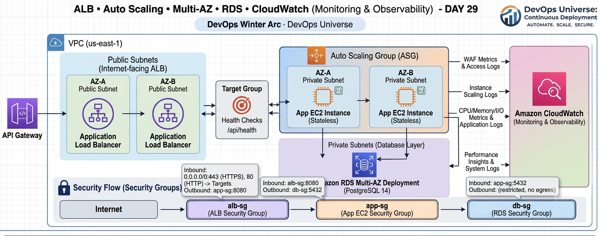
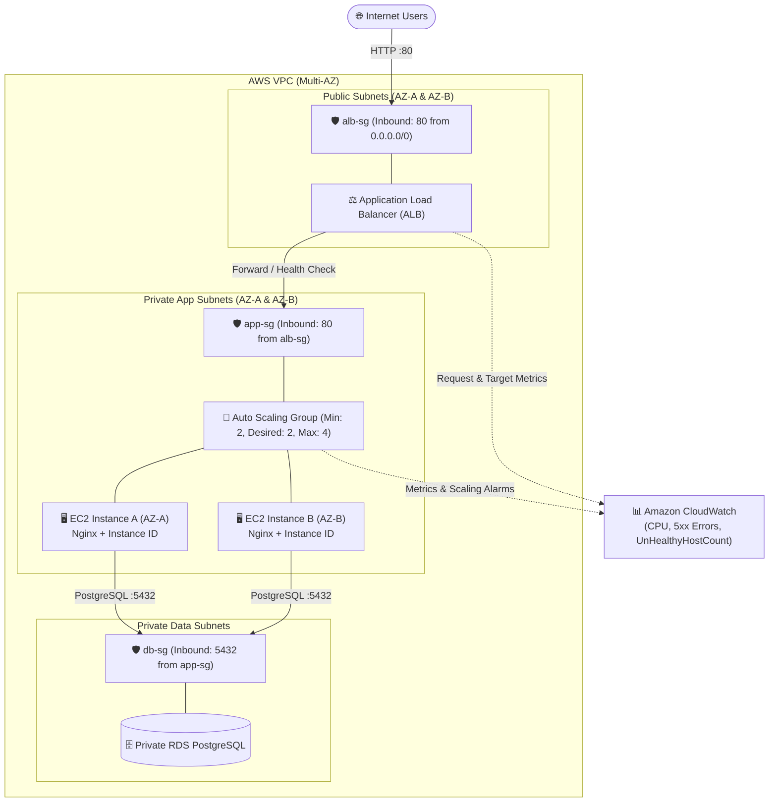

# 🚀 Day 29/90 — DevOps Winter Arc (AWS Week Capstone)

## 📌 Project Overview

This project represents the **AWS Week Capstone** of the DevOps Winter Arc challenge. It bridges core cloud infrastructure principles—such as VPC networking, load balancing, automated scaling, database isolation, and metric monitoring—into a single production-grade, highly available architecture.

---

## 🏗️ Architecture Diagram



### Visual Topology & Security Group Flow



### Text Flow Summary

```text
Users ➔ ALB (Public Subnets, AZ-A + AZ-B) ➔ Target Group ➔ EC2 App Instances (Private Subnets, Multi-AZ) ➔ Private RDS PostgreSQL
```

---

## 🛠️ Key Components & Implementation

1. **Networking (VPC):** Utilized a secure multi-AZ network topology featuring public subnets for the load balancer and isolated private subnets for compute and database tiers.

2. **Security Groups (Chained Least-Privilege):**
   * `alb-sg`: Accepts HTTP (`80`) traffic from the internet.
   * `app-sg`: Permits incoming traffic strictly from `alb-sg`.
   * `db-sg`: Restricts PostgreSQL (`5432`) access exclusively to `app-sg`.

3. **Launch Template & Compute:** Configured an Ubuntu instance template incorporating IMDSv2 security requirements, an SSM instance profile, and an automated Nginx bootstrap script rendering the live EC2 instance ID.

4. **Application Load Balancer & ASG:** Deployed an internet-facing ALB backed by an Auto Scaling Group (`Min: 2`, `Desired: 2`, `Max: 4`) spanning two Availability Zones with ELB health checks.

5. **Observability:** Configured CloudWatch metrics and alarms targeting host CPU utilization, 5xx errors, and target health (`UnHealthyHostCount`).

---

## 📁 Repository Structure

```text
day29-ha-app/
├── architecture/
│   └── aws-ha-architecture.png   # High-availability architecture diagram
├── scripts/                      # Nginx bootstrap scripts & user-data configuration
├── screenshots/                  # Verification & CloudWatch monitoring proofs
└── README.md                     # Project documentation & execution notes
```

---

## 🧪 Verification & Testing

* **Redundancy Test:** Sent repeated `curl` requests to the ALB DNS endpoint, confirming round-robin traffic distribution across multiple private EC2 instance IDs.
* **Failover Test:** Terminated an active worker node in the ASG to verify seamless zero-downtime auto-recovery and replacement.
* **Cleanup & Cost Control:** Performed full resource teardown (ASG, ALB, Target Group, Launch Template, CloudWatch alarms, and NAT/RDS resources) to prevent idle billing.

---

## 💡 Key Takeaways

* **Health-Check Alignment:** Target group health-check paths must map directly to an active application route (such as `/` on Nginx) to prevent false `502`/`503` errors.
* **Dependency-Aware Teardown:** Terminating EC2 instances alone does not clean up load balancers, target groups, or networking components—always verify each service after deletion.